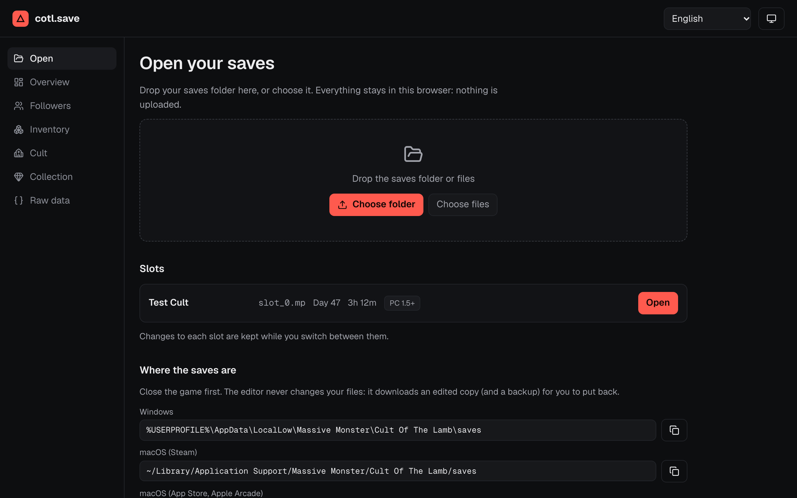
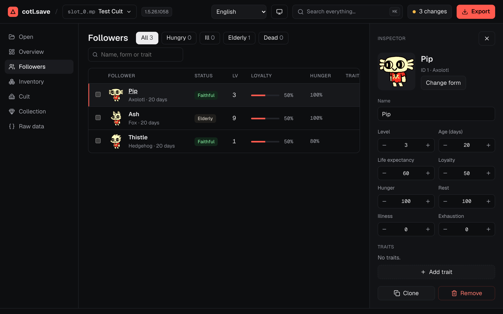
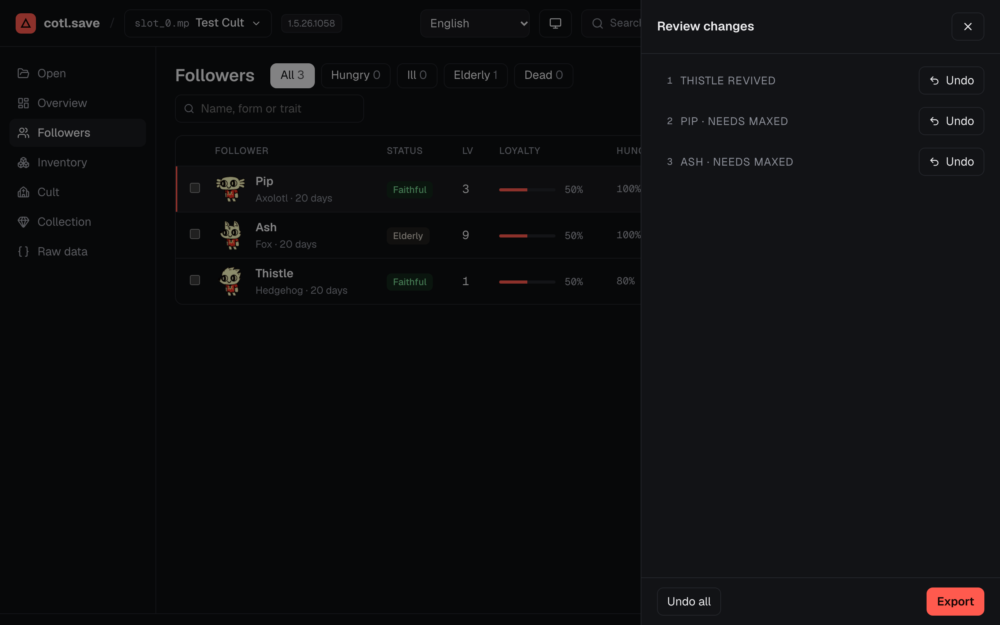

# Cult of the Lamb Save Editor

[](https://github.com/AuthFailed/cotl-save-editor/actions/workflows/pages.yml)

Edit *Cult of the Lamb* saves in your browser at **[save.cotl.info](https://save.cotl.info)**. Nothing is uploaded:
the save is read, edited and written back on your own machine. After an online visit, the app works offline;
game names and pictures are available offline once cached.
The production page's meta CSP restricts page resource origins. It does not apply to the service worker or Workbox;
those need a response CSP header ([#222](https://github.com/AuthFailed/cotl-save-editor/issues/222)).
Request-audit tests check the open, edit and export flow for uploads.

- **Followers**: name, form (with every portrait), level, age, loyalty, needs, traits; revive, clone, remove, and bulk
  "max needs".
- **Inventory**: items with their icons; set quantities, or add any item that both the save's schema and the game data know.
- **Cult and Collection**: doctrines, rituals, structures, crown abilities, tarot, relics, weapons, curses, fleeces,
  outfits and follower forms, each owned or locked, with "unlock all".
- **Raw data**: a tree of fields named by the save schema, with type-checked edits. Fields the schema can't name show by number and stay read-only; in JSON saves they are kept on export but not shown.
- **Safe by default**: every change is listed and undoable; the export is read back before it downloads, and the first
  export also downloads your original as a backup. A save that fails the codec's preservation checks opens read-only.
- **Formats**: PC 1.5+ (`.mp`), PC before 1.5 (`.json`), and, in beta, macOS App Store / Apple Arcade / iOS and Switch.
- UI text in 15 languages. Game names in the same languages, and pictures, from [api.cotl.info](https://api.cotl.info);
  field names from its versioned save schemas, with a bundled schema as the offline fallback.

## Using it

1. Close the game and back up your `saves` folder.
2. Open [save.cotl.info](https://save.cotl.info) and drop the folder in (the page lists where it is on each platform).
3. Edit, review, and export. Put the downloaded slot file back into the saves folder in place of the old one.
   The export keeps its original name and format. Allow both downloads on the first export: the edited save and its backup.

Changes stay with each slot while you switch between them. Export before closing or reloading the page.

## Screenshots

Made from the synthetic save the tests use: the cult and followers are invented.

| Open | Followers | Review |
|---|---|---|
|  |  |  |

## Browser support

Use an up-to-date desktop browser over HTTPS (or localhost for development). Expected minimums are:

| Browser | Version |
|---|---|
| Chrome / Edge | 107+ |
| Firefox | 121+ |
| Safari | 16.4+ |

These are feature-based minimums, not a tested version matrix. CI runs the bundled Chromium browser only.
The build uses [Vite 7's browser targets](https://v7.vite.dev/config/build-options#build-target);
[CSS `:has()`](https://developer.mozilla.org/en-US/docs/Web/CSS/Reference/Selectors/:has) for tooltips sets the Firefox minimum,
and [`CompressionStream` / `DecompressionStream`](https://developer.mozilla.org/en-US/docs/Web/API/Compression_Streams_API)
for Apple saves set the Safari minimum.

The app also uses native `<dialog>` for pickers, search, details and Review; WebCrypto for encrypted PC saves;
and the Clipboard API for copying save paths. A service worker caches the app and the game data it has loaded for offline use.
Folder selection uses [`webkitdirectory`](https://developer.mozilla.org/en-US/docs/Web/API/HTMLInputElement/webkitdirectory),
and folder drops use `webkitGetAsEntry`. Folder picking varies on phones: use **Choose files** if it is unavailable,
and select the slot and its matching meta file together. Exports download files; replacing the originals is a manual step.

## Development

Use Node 24 (`.nvmrc`). See [CONTRIBUTING.md](CONTRIBUTING.md) for setup, all checks, translations and save-data privacy rules.

```bash
npm ci             # install locked dependencies
npm run dev        # http://localhost:5173
npm test           # codec and model tests
npm run typecheck  # TypeScript
npm run check      # Svelte components
npm run e2e        # production build and browser tests
```

Browser tests use port 5179 by default. If it is busy, use an optional override: `E2E_PORT=5279 npm run e2e`.

Optional tests against real saves skip on a clean checkout. Everything else uses synthetic saves built from the published schema.
Pushes to `main` deploy to GitHub Pages.

Design: [docs/specs](docs/specs/2026-10-31-cotl-save-editor-design.md).

The built site includes [third-party licence notices](https://save.cotl.info/third-party-licenses.txt) for its libraries, icons and fonts.
Game art and data are not covered by these licences.

## Credits

The save formats were first worked out by
[Matteo-Fattorini/cotl-save-editor](https://github.com/Matteo-Fattorini/cotl-save-editor),
[Gu-BRA/CultOfTheLamb-SaveEditor](https://github.com/Gu-BRA/CultOfTheLamb-SaveEditor),
[PrivateiFox/cotl-save-converter](https://github.com/PrivateiFox/cotl-save-converter) and
[Sanchos-dev/cotl-save-sync](https://github.com/Sanchos-dev/cotl-save-sync).

Unofficial fan project; *Cult of the Lamb*, its data and art belong to Massive Monster and Devolver Digital.
